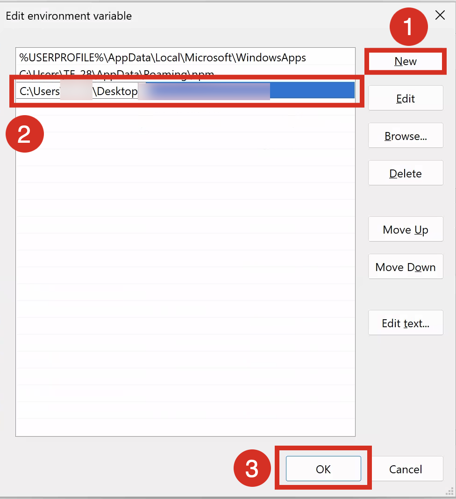

# Install the Spec-Kit CLI

A detailed description of the installation process for the Spec-Kit CLI is available at: https://sap.github.io/iac-spec-kit-for-sap-business-ai-platform/setup/

In acase you are on Windows and want to use the binary of the Spec-Kit CLI, follow the instructions provided here:

1. Navigate to the project's GitHub repository [release page](https://github.com/SAP/iac-spec-kit-for-sap-business-ai-platform/releases)
2. Download the latest release of the spec-kit CLI for Windows (`*_windows_amd64.zip`)
3. Extract the downloaded ZIP file to the Desktop

Add it to your system's PATH for easier access. For the later you must add the location of your extracted binary to your system's PATH.

1. Right click on the Windows Logo and click "System"

      

2. Click on "Advanced system settings"

      

3. Click on "Environment Variables ..."

      

4. Click on the Path Variable and then click "Edit"

      

5. Click "New" and add the path to the extracted spec-kit CLI binary

      

6. Click "OK" a few times to close all the dialog boxes


Verify that the spec-kit CLI is correctly installed and accessible from your terminal by opening a new terminal and running:

```powershell
sap-iac
```

You should see the following output:

```powershell
Infrastructure-as-Code Specification Toolkit for SAP Business AI Platform

Usage:
  sap-iac [command]

Available Commands:
  catalogue   Manage the service parameters catalogue
  completion  Generate the autocompletion script for the specified shell
  help        Help about any command
  init        Bootstrap or update a project
  version     Print the binary version

Flags:
  -h, --help   help for sap-iac

Use "sap-iac [command] --help" for more information about a command.
```
