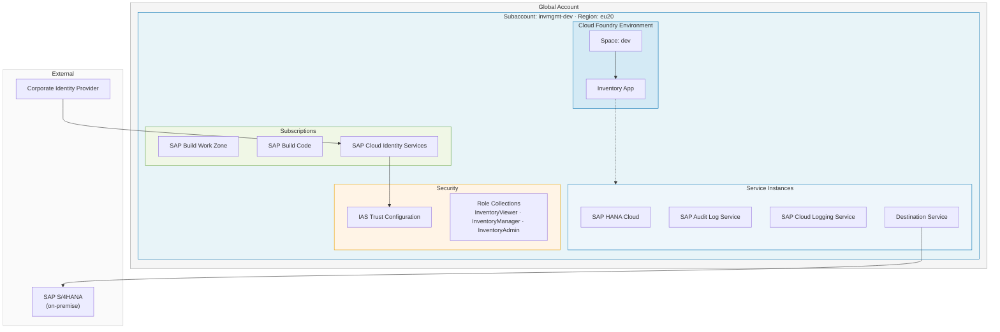

# Motivation

**Managing infrastructure manually** by clicking through a UI Cockpit or copy-pasting infrastructure **doesnt work** especially:-
- A colleague needs to rebuild your exact environment.
- When compliance audits ask **why a specific service plan was chosen**

When AI tools arrived, the natural reflex was to prompt for code directly:

> **Prompt** ➔ **LLM generates code** ➔ **Iterate until it works**

While great for quick prototypes, **100 tries can yield 100 different outcomes** with **zero record** of **why** decisions were made.

> [!IMPORTANT]
> **The Problem in Production**
> - multiple people are involved in creating and maintaining the IaC code
> - a stable setup is required as IaC is the foundation for successful app development
> - infrastructure management always requires auditability and traceability

---
The question therefore is: Do we have a sustainable alternative bringing together benefits of IaC and AI-driven development?

### The Answer: Spec-driven Development

Instead of prompting *what to build*, you **prompt** on **what the system should do**

You define specifications:
- The behaviour of the system
- Constraints (Guardrails)

<b>These specifications drive the code generation executed by the LLM/agent. </b>

At each stage of the spec-driven development flow you can review, approve, or refine before advancing. In addition every step is documented as markdown file(s).

This approach comes with the following benefits:

- it reduces ambiguity for coding agents, which means fewer correction loops
- the spec becomes the **primary artifact** that drives all downstream activities mainly the code generation
- governance rules are encoded once and enforced automatically

However, the shift from coding to specifying is challenging. Instead of writing/reviewing code it's now **effectively describing what you want to build** to an agent.

While one might get the impression that spec-driven is a return back to waterfall, it is not. The spec-driven approach is iterative and agile, but it is a more disciplined approach compared to vibe coding. You can at any point revisit the steps and refine the specification.

 

## The Scenario

Your team is building an **Inventory Management application** using SAP Cloud Application Programming Model (CAP). As a prerequisite, the developer environment on SAP Business AI Platform must be provisioned. This task is what you will build in this session together with an agent.

The application has the following **requirements** mapping to the corresponding platform resources:

| Requirement | Service |
|---|---|
| Cloud Foundry runtime for deploying and testing the CAP app | Cloud Foundry Environment |
| Persistent database for inventory data | SAP HANA Cloud |
| Compliance audit trail for all inventory changes | SAP Audit Log Service |
| Centralized application and runtime logs | SAP Cloud Logging Service |
| Fiori Launchpad for the inventory UI | SAP Build Work Zone, standard edition |
| Development tools and CI/CD pipeline | SAP Build Code |
| Enterprise authentication (no default SAP ID Service) | SAP Cloud Identity Services |

In addition, the company has the following **Governance constraints:**

- All data must remain in the EU
- Subaccounts must follow a naming pattern
- The environment should be Cloud Foundry
- HANA Cloud is a metered service — cost center tagging is mandatory on all subaccounts
- SAP Cloud Identity Services is required as the identity provider — the default SAP ID Service is not permitted

## The Flow

Spec-driven development is a disciplined approach. All spec-kits support the user with guidance along a defined flow via a CLI and corresponding skills for the agentic tooling of your choice. The flow for our spec-kit is structured in the following steps:

1. Initialize the project via a CLI
2. Define the governance constraints
3. Define the overall scenario
4. Detail the account setup
5. Detail the service setup
6. Detail the security setup
7. Detail the connectivity setup
8. Define the tasks
9. Evaluate the design
10. Generate the Terraform code
11. Deploy the generated Terraform code

Each step corresponds to one exercise where you will execute the task and get an explanation of the intention and the technical foundation.

👉 Continue to - [Exercise 1 - Technical Setup](../ex1/README.md)
