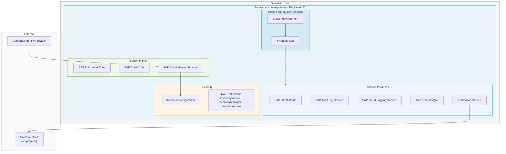
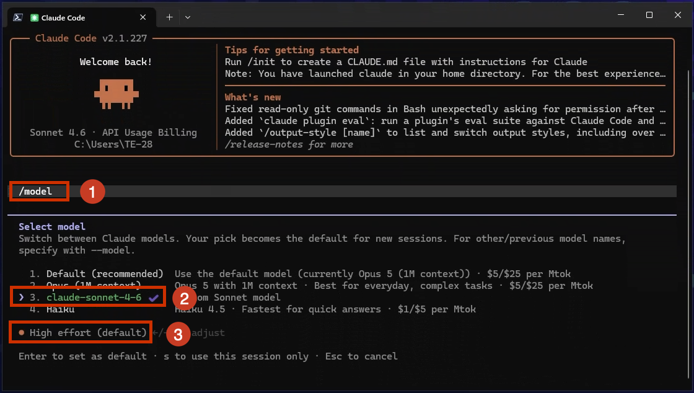
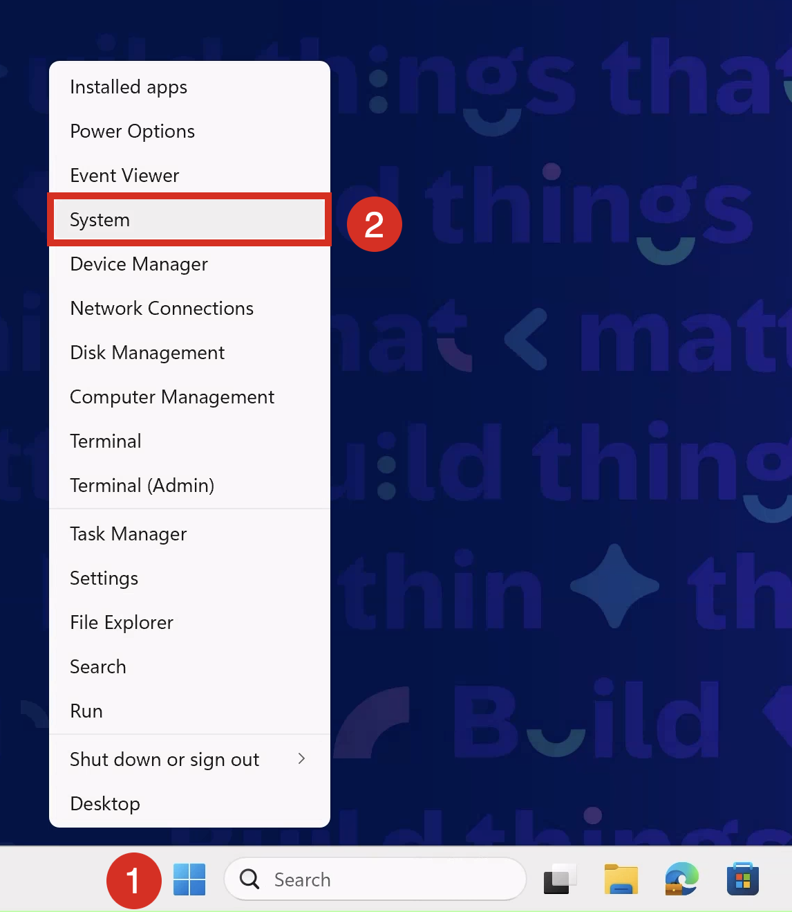
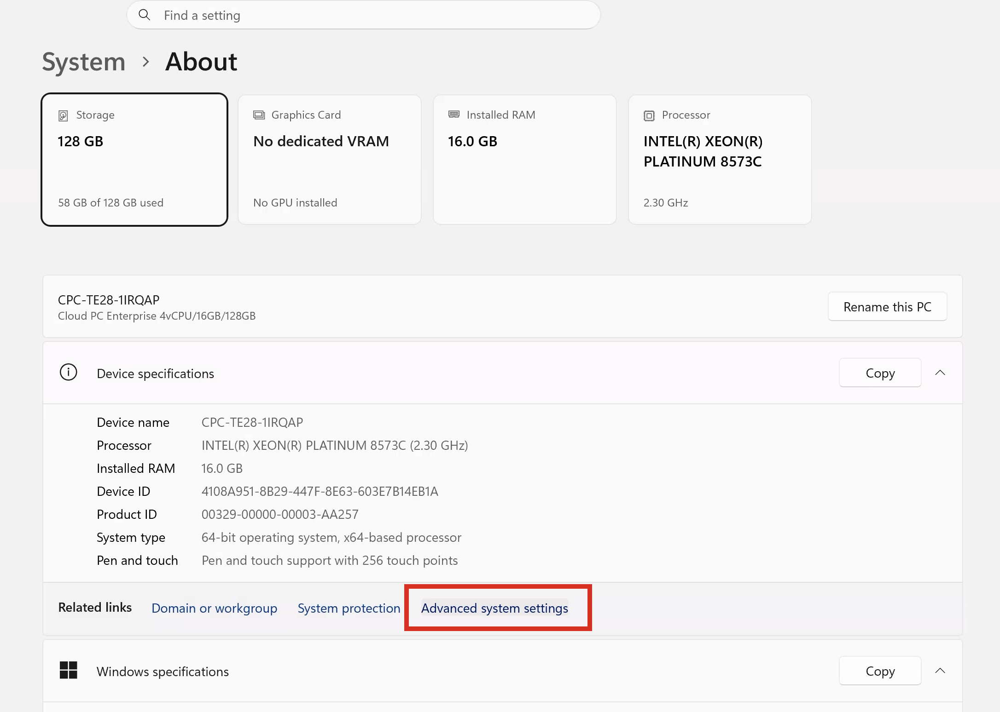
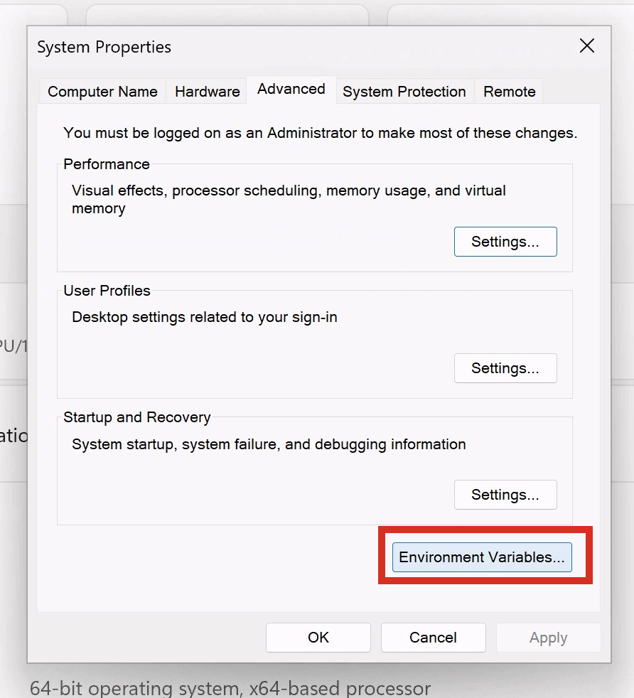
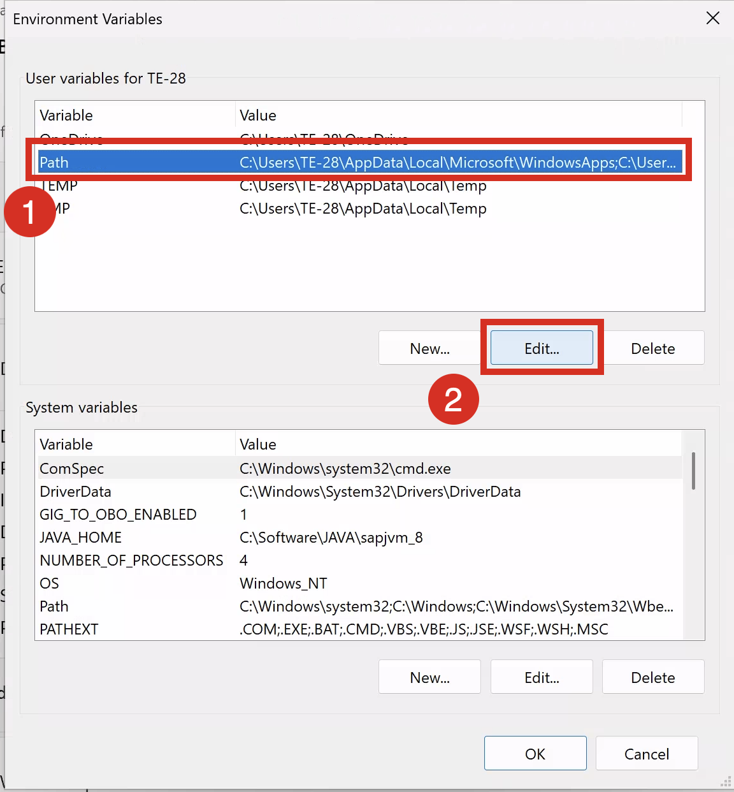

# Getting started

## Motivation

Building cloud infrastructure manually — clicking through the cockpit, copying Terraform snippets from the internet — works once. But the second time a colleague needs to recreate the same environment, or the third time a compliance auditor asks *why did you choose this service plan*, the gaps become expensive.

When AI coding tools arrived, the natural reaction was to replace the clicking with prompts. The typical flow is: write a prompt → LLM generates code → iterate the result with edits until it lands on something usable.

This is great for quick prototyping, but in this flow 100 tries may yield 100 different implementations, and there is no clear record of *why* the model made the decisions it did.

Looking at typical Infrastructure as Code (IaC) projects that are much more complex this flow is a bad fit as:

- multiple people are involved in creating and maintaining the IaC code
- a stable setup is required as IaC is the foundation for app development
- infrastructure management always requires auditability and traceability

The question therefore is: What is the alternative?

A disciplined alternative is the so called **Spec-driven Development**.

The approach is built on the idea that instead of prompting *what to build*, you prompt *what the system should do* (or in IaC terms what the infrastructure should look like) which targets its **behavior and constraints**.

Basically this approach produces a **specification** (the "contract"), which drives:

1. A **requirements document** (the authoritative hierarchy for the project)
2. A **design document** with concrete implementation to-dos
3. Only then: **code generation** is executed by the LLM/agent

At each stage you can review, approve, or refine before advancing — nothing is implemented until the specification is agreed on.

This approach comes with the following benefits:

- it reduces ambiguity for coding agents, which means fewer back-and-forth correction loops
- the spec becomes the **primary artifact** that drives all downstream work: implementation, tests, documentation, verification
- governance rules are encoded once and enforced automatically — the agent will stop and warn you if your service choices violate them

However, the shift from coding to specifying is the hardest skill: instead of writing/reviewing code it's now **effectively conveying what you want to build** to an agent.

> [!NOTE]
> While one might get the impression that spec-driven is a return back to waterfall, it is not. The spec-driven approach is iterative and agile, but it is a more disciplined approach compared to a vibe coding approach. You can at any point revisit the steps and refine the specification.

## The Scenario

Your team is building an **Inventory Management application** using SAP Cloud Application Programming Model (CAP). The app tracks stock levels, purchase orders, and goods movements across a manufacturing company's warehouses.

Before a single line of application code can be written, the developer environment on SAP Business AI Platform must exist and be correctly configured. This is what you will build today together with an agent.

**What the environment needs:**

| Component | Purpose |
|---|---|
| Cloud Foundry space | Runtime where the CAP application is deployed and tested |
| SAP HANA Cloud | Persistent database for inventory data (products, warehouses, stock levels) |
| SAP Audit Log Service | Compliance requirement — every create/update/delete on inventory records must be logged |
| SAP Cloud Logging Service | Centralized log aggregation for developers to trace issues |
| SAP Build Work Zone | Fiori launchpad — the entry point for end users accessing the inventory UI |
| SAP Build Code | Integrated development environment with CAP tooling and CI/CD |
| SAP Cloud Identity Services | Enterprise IdP — the company requires all applications to use their corporate identity provider, not the default SAP ID Service |

**Governance constraints the company has:**

- All data must remain in the EU
- Subaccounts must follow a naming pattern
- The environment should be Cloud Foundry
- HANA Cloud is a metered service — cost centre tagging is mandatory on all subaccounts
- SAP Cloud Identity Services is required as the identity provider — the default SAP ID Service is not permitted

These constraints will be encoded in the very first exercise and enforced automatically by every subsequent step.



## The Flow

Spec-driven development is a disciplined approach. All spec-kits support the user with guidance along a defined flow via a CLI and corresponding skills for the agentic tooling of your choice. The flow for our spec-kit is structured in the following steps:

1. Initialize the project via a CLI
2. Define the governance constraints
3. Define the overall scenario
4. Detail the account setup
5. Detail the service setup
6. Detail the security setup
7. Detail the connectivity setup
8. Define the tasks
9. Evaluate the design
10. Generate the Terrarform code

After that you deploy the generated Terraform code.

At the end of this session you will have finished all steps depicted in the following diagram:

```mermaid
flowchart LR
    E1["Ex 1\nInitialize\nproject"]
    E2["Ex 2\n/sap-iac.govern\nGovernance"]
    E3["Ex 3\n/sap-iac.scenario\nScenario"]
    E4["Ex 4\n/sap-iac.accounts\nAccounts"]
    E5["Ex 5\n/sap-iac.services\nServices"]
    E6["Ex 6\n/sap-iac.security\nSecurity"]
    E7["Ex 7\n/sap-iac.connectivity\nConnectivity"]
    E8["Ex 8\n/sap-iac.tasks\nTasks"]
    E9["Ex 9\n/sap-iac.design\nDesign"]
    E10["Ex 10\n/sap-iac.generate\nGenerate"]
    E11["Ex 11\nterraform apply\nDeploy"]

    E1 --> E2 --> E3 --> E4 --> E5 --> E6 --> E7 --> E8 --> E9 --> E10 --> E11

    style E2 fill:#fff0cc,stroke:#e8a000
    style E9 fill:#e6f2ff,stroke:#0070b1
    style E10 fill:#e6ffe6,stroke:#5a9e3a
```



Each step corresponds to one exercise where you will execute the task and get an explanation of the intention and the technical foundation.

## Technical Setup

> [!NOTE]
> All commands in these exercises work on **macOS, Linux, and Windows**. On Windows, use **PowerShell7** (recommended) — **not** Git Bash — to ensure environment variable syntax matches the instructions in Exercise 10. The Claude Code slash commands (`/sap-iac.*`) and all Terraform commands are platform-independent.

Before starting with the exercises some technical setup is required to ensure that all tools and services are properly configured.

You need the following components set up before starting the exercises:

- MCP Server for Terraform
- Configure Claude code to connect to the MCP Server for Terraform
- Install the Spec-kit CLI
- Check your access to your Business AI Platform account via the cockpit and btp CLI

The following sections guide you through the setup process for each of the required components.

### MCP Server for Terraform

We require the [MCP server for Terraform](https://github.com/hashicorp/terraform-mcp-server) to give the agent access to the information about the Terraform providers available on the Terraform registry. On the system we are using [podman](https://podman.io/) as the container runtime. To install and run the MCP server, open a Powershell window and execute the following commands:

1. Start podman:

      ```powershell
      podman machine start
      ```

2. Install and start the MCP server:

      ```powershell
      podman run -i --rm hashicorp/terraform-mcp-server
      ```

> [!NOTE]
> Some error might occur stating the the `TFE client` and the `TFE tools` will not be available. This is okay as we do not connect to a Terraform Enterprise instance.

You can stop the MCP server by pressing `Ctrl+C` in the terminal where it is running.

### Wire up Claude Code to the MCP Server

We need to setup the connection between Claude and the MCP server for Terraform that we just installed. To do so go to your terminal windows and enter the following command:

```powershell
claude mcp add terraform -s user -t stdio -- podman run -i --rm hashicorp/terraform-mcp-server
```
You should get a confirmation message indicating that the MCP server has been successfully added to Claude Code:

```powershell
Added stdio MCP server terraform with command podman run -i --rm hashicorp/terraform-mcp-server to user config
```

Verify that the MCP server has been correctly added to Claude Code by listing the configured MCP servers:

```powershell
claude mcp list
```
You should see an entry for the `terraform` MCP server, confirming that it is connected to Claude Code.

### Verify the model used in Claude

To ensure that Claude is using the correct model, open a terminal and run the following command:

```powershell
claude
```

Next key in `/model` and validate that the model is `Sonnet 4.6` and the reasing effort is `High` as shown in this screenshot:



If this is not the case select the right model and/or adjust the reasoning effort accordingly.

### Install the Spec-kit CLI

The central ingredient for this exercise is the Spec-kit CLI, which allows you to interact with the spec-driven development framework. You need to install it and ensure it is available in your system's PATH.

1. Navigate to the project's GitHub repository [release page](https://github.com/SAP/btp-iac-spec-kit/releases)
2. Download the latest release of the Spec-kit CLI for Windows (`*_windows_amd64.zip`)
3. Extract the downloaded ZIP file to the Desktop

Add it to your system's PATH for easier access.
For the later you must add the extracted binary to your system's PATH.

1. Right click on the Windows Logo and click "System"

      

2. Click on "Advanced system settings"

      

3. Click on "Environment Variables ..."

      

4. Click on the Path Variable and then click "Edit"

      

5. Click "New" and add the path to the extracted spec-kit CLI binary

      

6. Click "OK" a few times to close all the dialog boxes


Verify that the spec-kit CLI is correctly installed and accessible from your terminal by opening a new terminal and running:

```powershell
sap-iac
```

You should see the following output:

```powershell
Infrastructure-as-Code Specification Toolkit for SAP Business AI Platform

Usage:
  sap-iac [command]

Available Commands:
  catalogue   Manage the service parameters catalogue
  completion  Generate the autocompletion script for the specified shell
  help        Help about any command
  init        Bootstrap or update a project
  version     Print the binary version

Flags:
  -h, --help   help for sap-iac

Use "sap-iac [command] --help" for more information about a command.
```

### Validate your access

As we want to deploy resources to the SAP Business AI Platform, you need to have access to the platform. We validate this both via the cockpit and the btp CLI.

#### Cockpit

- Open a browser and navigate to the URL <https://emea.cockpit.btp.cloud.sap/cockpit/?idp=ainfvn15r.accounts.ondemand.com#/>
- Log in via the credential provided by the HandsOn Team during the session

Keep the browser window open as you will need the subdomain of the gloabl account in the next exercise.

#### btp CLI

Verify your access via the btp CLI by running:

```powershell
btp login --idp ainfvn15r --user 'XP265-<your-group-number' --password '<your-password>'
```

> [!NOTE]
> Put the username and the password into single quotes

Confirm the defaulted CLI server URL (`https://cli.btp.cloud.sap`)

You should see a success message indicating that you have successfully logged in via the btp CLI.

## 📋 Summary

You now understand the motivation for spec-driven development, the inventory management scenario and its constraints we use in this exercise.

In addition, you have installed the prerequisites for the exercise and validated your access to the SAP Business AI Platform. Now the real fun can start!

Continue to - [Exercise 1 - Initialize the project](../ex1/README.md)
