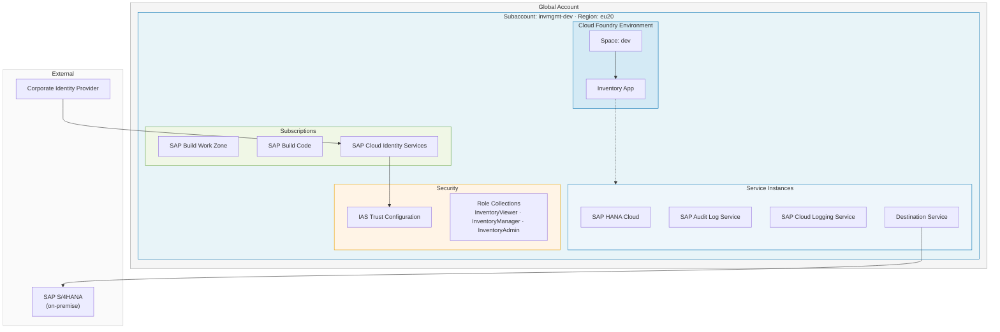
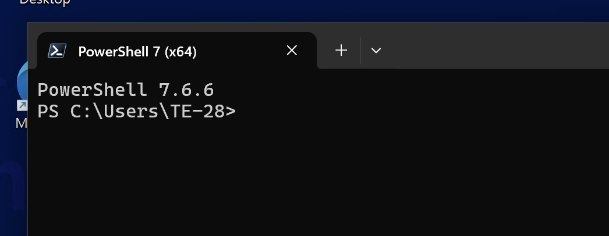

# Getting started

## Motivation

**Managing infrastructure manually** by clicking through a UI Cockpit or copy-pasting infrastructure **doesnt work** especially:-
- A colleague needs to rebuild your exact environment.
- When compliance audits ask **why a specific service plan was chosen**


When AI tools arrived, the natural reflex was to prompt for code directly:

> **Prompt** ➔ **LLM generates code** ➔ **Iterate until it works**

While great for quick prototypes, **100 tries can yield 100 different outcomes** with **zero record** of **why** decisions were made.

> [!IMPORTANT]
> **The Problem in Production**  
> - multiple people are involved in creating and maintaining the IaC code
> - a stable setup is required as IaC is the foundation for successful app development
> - infrastructure management always requires auditability and traceability

---
The question therefore is: Do we have a sustainable alternative bringing together benefits of IaC and AI-driven development?


### The Answer: Spec-driven Development

Instead of prompting *what to build*, you **prompt** on **what the system should do**

You define specifications:
- The behaviour of the system
- Constraints (Guardrails)


<details>

<summary><b>These specifications drive the code generation executed by the LLM/agent. </b></summary>
At each stage of the spec-driven development flow you can review, approve, or refine before advancing. In addition every step is documented as markdown file(s).


This approach comes with the following benefits:

- it reduces ambiguity for coding agents, which means fewer correction loops
- the spec becomes the **primary artifact** that drives all downstream activities mainly the code generation
- governance rules are encoded once and enforced automatically

However, the shift from coding to specifying is challenging. Instead of writing/reviewing code it's now **effectively describing what you want to build** to an agent.

> [NOTE]
>
> While one might get the impression that spec-driven is a return back to waterfall, it is not. The spec-driven approach is iterative and agile, but it is a more disciplined approach compared to vibe coding. You can at any point revisit the steps and refine the specification.
</details>

</br>


## The Scenario

Your team is building an **Inventory Management application** using SAP Cloud Application Programming Model (CAP). As a prerequisite, the developer environment on SAP Business AI Platform must be provisioned. This task is what you will build in this session together with an agent.

The application has the following **requirements** mapping to the corresponding platform resources:

| Requirement | Service |
|---|---|
| Cloud Foundry runtime for deploying and testing the CAP app | Cloud Foundry Environment |
| Persistent database for inventory data | SAP HANA Cloud |
| Compliance audit trail for all inventory changes | SAP Audit Log Service |
| Centralized application and runtime logs | SAP Cloud Logging Service |
| Fiori Launchpad for the inventory UI | SAP Build Work Zone, standard edition |
| Development tools and CI/CD pipeline | SAP Build Code |
| Enterprise authentication (no default SAP ID Service) | SAP Cloud Identity Services |


In addition, the company has the following **Governance constraints:**

- All data must remain in the EU
- Subaccounts must follow a naming pattern
- The environment should be Cloud Foundry
- HANA Cloud is a metered service — cost center tagging is mandatory on all subaccounts
- SAP Cloud Identity Services is required as the identity provider — the default SAP ID Service is not permitted




## The Flow

Spec-driven development is a disciplined approach. All spec-kits support the user with guidance along a defined flow via a CLI and corresponding skills for the agentic tooling of your choice. The flow for our spec-kit is structured in the following steps:

1. Initialize the project via a CLI
2. Define the governance constraints
3. Define the overall scenario
4. Detail the account setup
5. Detail the service setup
6. Detail the security setup
7. Detail the connectivity setup
8. Define the tasks
9. Evaluate the design
10. Generate the Terraform code
11. Deploy the generated Terraform code

Each step corresponds to one exercise where you will execute the task and get an explanation of the intention and the technical foundation.

## Technical Setup

<details>
<summary>On Windows, use <b>PowerShell</b></summary>

— <b>NOT Git Bash</b> — to ensure environment variable syntax matches the instructions in Exercise 10. The Claude Code slash commands (`/sap-iac.*`) and all Terraform commands are platform-independent. This hands-on session is done on Windows only; therefore, the following instructions focus on this OS. When doing the exercises on your own on a different OS, look up the appropriate commands for your OS.

<br>




</details>
<br>
Before starting with the exercises some technical setup is required to ensure that all tools and services are properly configured.

You need the following components set up before starting the exercises:

1. MCP Server for Terraform
2. Configure Claude Code to connect to the MCP Server for Terraform
3. Install the spec-kit CLI
4. Check your access to your Business AI Platform account via the cockpit and btp CLI

The following sections guide you through the setup process for each of the required components.

### MCP Server for Terraform

We require the [MCP server](https://modelcontextprotocol.io/docs/2026-07-28/learn/server-concepts) for [Terraform](https://github.com/hashicorp/terraform-mcp-server) to give the agent access to the information about the Terraform providers available on the Terraform registry. 

On the system we are using [podman](https://podman.io/) as the container runtime. To install and run the MCP server, open a PowerShell window and execute the following commands:

1. Start podman:

      ```powershell
      podman machine start
      ```

2. Install and start the MCP server:

      ```powershell
      podman run -i --rm hashicorp/terraform-mcp-server
      ```

> [!NOTE]
> Some error might occur stating the the `TFE client` and the `TFE tools` will not be available. This is okay as we do not connect to a Terraform Enterprise instance.

Stop the MCP server by pressing `Ctrl+C` in the terminal where it is running. This step was required to initially download the MCP server image. In the next step we will instruct Claude Code to start the MCP server on its own.

### Wire up Claude Code to the MCP Server

We need to setup the connection between Claude and the MCP server for Terraform that we just installed. To do so go to your Powershell terminal windows and enter the following command:

```powershell
claude mcp add terraform -s user -t stdio -- podman run -i --rm hashicorp/terraform-mcp-server
```
You should get a confirmation message indicating that the MCP server has been successfully added to Claude Code:

```powershell
Added stdio MCP server terraform with command podman run -i --rm hashicorp/terraform-mcp-server to user config
```

Verify that the MCP server has been correctly added to Claude Code by listing the configured MCP servers:

```powershell
claude mcp list
```
You should see an entry for the `terraform` MCP server, confirming that it is connected to Claude Code.

### Verify the model used in Claude

To ensure that Claude is using the correct model, in the Powershell terminal run the following command:

```powershell
claude
```
You can select `Yes, I trust this folder` to continue.


Next, enter `/model` and validate that the model is `Sonnet 4.6` and the reasoning effort is `High`, as shown in this screenshot:


If this is not the case select the right model and/or adjust the reasoning effort accordingly.

Leave Claude for now by entering `/exit` in the terminal.

### Install the spec-kit CLI

> [!NOTE]
> If you are doing the hands-on on your own, take a look at the [documentation](https://sap.github.io/iac-spec-kit-for-sap-business-ai-platform/setup/) for the installation of the spec-kit CLI on the different platforms.

The central tool for this exercise is the spec-kit CLI. You need to install it manually:

1. Open a terminal window.
2. Run the following command in powershell terminal to download and install the spec-kit CLI:

      ```powershell
      iwr -useb https://raw.githubusercontent.com/SAP/iac-spec-kit-for-sap-business-ai-platform/refs/heads/main/sap-iac-install.ps1 | iex
      ```

<details>
<summary>Easy installation with winget will be available soon</summary>
The CLI will be made available as a winget package to support the standard installation process on Windows. However, the package review process takes a bit, so we will use a **workaround** in this session
</details>
</br>


Verify that the spec-kit CLI is correctly installed and accessible from your terminal by opening a new terminal and running:

```powershell
sap-iac
```

You should see the following output:

```powershell
Infrastructure-as-Code Specification Toolkit for SAP Business AI Platform

Usage:
  sap-iac [command]

Available Commands:
  catalogue   Manage the service parameters catalogue
  completion  Generate the autocompletion script for the specified shell
  help        Help about any command
  init        Bootstrap or update a project
  version     Print the binary version

Flags:
  -h, --help   help for sap-iac

Use "sap-iac [command] --help" for more information about a command.
```

### Validate your access to the platform

As we want to deploy resources to the SAP Business AI Platform, you need to have access to the platform. Validate this both via the cockpit and the btp CLI.

Your username is in the format `XP265-<0XX>`, where `0XX` should be replaced with your group number. The email of the user is `xp265-<0XX>@education.cloud.sap`
Your Password is the one provided by the hands-on team during the session.

#### Cockpit

- Open a browser and navigate to the URL <https://emea.cockpit.btp.cloud.sap/cockpit/?idp=ainfvn15r.accounts.ondemand.com#/>
- Log in with the credentials provided by the hands-on team during the session

Keep the browser window open as you will need the subdomain of the global account in the next exercise.

#### btp CLI

Verify your access via the btp CLI by running, replace the `0XX` in the username with your group number::

```powershell
btp login --idp ainfvn15r --user 'XP265-<0XX>' --password '<your-password>'
```

> [!NOTE]
> Put the username and the password into single quotes

Confirm the defaulted CLI server URL (`https://cli.btp.cloud.sap`)

You should see a success message indicating that you have successfully logged in via the btp CLI.

## 📋 Summary

You now understand the motivation for spec-driven development, the hands-on scenario and its constraints.

In addition, you have installed the prerequisites for the exercises and validated your access to the SAP Business AI Platform. Now the real fun can start!

Continue to - [Exercise 1 - Initialize the project](../ex1/README.md)
