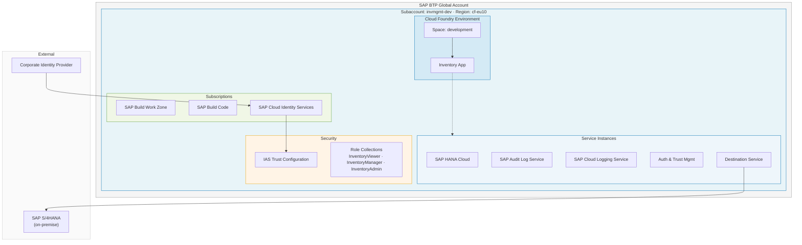

# Getting started

## Motivation

Building cloud infrastructure manually — clicking through cockpits, copying Terraform snippets from the internet — works once. But the second time a colleague needs to recreate the same environment, or the third time a compliance auditor asks *why did you choose this service plan*, the gaps become expensive.

When AI coding tools arrived, the natural reaction was to replace the clicking with prompts. The typical vibe coding flow is: write a prompt → LLM generates code → iterate with edits until it lands on something usable.

This is great for quick prototyping, but in this flow 100 tries may yield 100 different implementations, and there is no clear record of *why* the model made the decisions it did.

Looking at typical IaC projects that are much more complex this is a bad fit as:

- multiple people are involved in creating and maintaining the IaC code
- a stable setup is required as IaC is the foundation for app development
- infrastructure management always requires auditability and traceability

The question therefore is: What is the alternative?

A disciplined alternative is the so called **Spec-driven Development**.

The approach is built on the idea that instead of prompting *what to build*, you prompt *what the system should do* (or in IaC terms what the infrastructure should look like) which targets its **behavior and constraints**.

Basically this approach produces a **specification** (the "contract"), which then drives:

1. A **requirements document** (the authoritative hierarchy for the project)
2. A **design document** with concrete implementation to-dos
3. Only then: **code generation** by the LLM/agent

At each stage you can review, approve, or refine before advancing — nothing is implemented until the spec is agreed on.

This approach comes with the following benefits:

- it reduces ambiguity for coding agents, which means fewer back-and-forth correction loops
- the spec becomes the **primary artifact** that drives all downstream work: implementation, tests, documentation, verification
- governance rules are encoded once and enforced automatically — the AI agent will stop and warn you if your service choices violate them

However, the shift from coding to specifying is the hardest skill: instead of writing/reviewing code it's now **effectively conveying what you want to build** to an LLM or agent.

> [!NOTE]
> While one might get the impression that spec-driven is a return back to waterfall, it is not. The spec-driven approach is still iterative and agile, but it is a more disciplined approach compared to a vibe coding approach.

## The Scenario

Your team is building an **Inventory Management application** using SAP Cloud Application Programming Model (CAP). The app tracks stock levels, purchase orders, and goods movements across a manufacturing company's warehouses.

Before a single line of application code can be written, the developer environment on SAP BTP must exist and be correctly configured. This is what you will build today.

**What the environment needs:**

| Component | Purpose |
|---|---|
| Cloud Foundry space | Runtime where the CAP application is deployed and tested |
| SAP HANA Cloud | Persistent database for inventory data (products, warehouses, stock levels) |
| SAP Audit Log Service | Compliance requirement — every create/update/delete on inventory records must be logged |
| SAP Cloud Logging Service | Centralized log aggregation for developers to trace issues |
| SAP Build Work Zone | Fiori launchpad — the entry point for end users accessing the inventory UI |
| SAP Build Code | Integrated development environment with CAP tooling and CI/CD |
| SAP Cloud Identity Services | Enterprise IdP — the company requires all BTP applications to use their corporate identity provider, not the default SAP ID Service |

**Governance constraints the company has:**

- All BTP data must remain in the EU (region `cf-eu10`)
- Subaccounts must follow the naming pattern `invmgmt-<env>` (e.g., `invmgmt-dev`, `invmgmt-prod`)
- HANA Cloud is a metered service — cost centre tagging is mandatory on all subaccounts
- SAP Cloud Identity Services is required as the identity provider — the default SAP ID Service is not permitted

These constraints will be encoded in the very first exercise and enforced automatically by every subsequent step.

## The Flow

Spec-driven development is a disciplined approach. All spec-kits support the user with guidance along a defined flow via a CLI and corresponding skills for the agentic tooling of your choice. The flow for our spec-kit is structured in the following steps:

1. Initialize the project
2. Define the governance constraints
3. Define the scenario
4. Detail the account setup
5. Detail the service setup
6. Detail the security setup
7. Define the tasks
8. Evaluate the design
9. Generate the code

```mermaid
flowchart LR
    E1["Ex 1\nInitialize\nproject"]
    E2["Ex 2\n/btp-iac.govern\nGovernance"]
    E3["Ex 3\n/btp-iac.scenario\nScenario"]
    E4["Ex 4\n/btp-iac.accounts\nAccounts"]
    E5["Ex 5\n/btp-iac.services\nServices"]
    E6["Ex 6\n/btp-iac.security\nSecurity"]
    E7["Ex 7\n/btp-iac.tasks\nTasks"]
    E8["Ex 8\n/btp-iac.design\nDesign"]
    E9["Ex 9\n/btp-iac.generate\nGenerate"]
    E10["Ex 10\nterraform apply\nDeploy"]

    E1 --> E2 --> E3 --> E4 --> E5 --> E6 --> E7 --> E8 --> E9 --> E10

    style E2 fill:#fff0cc,stroke:#e8a000
    style E9 fill:#e6f2ff,stroke:#0070b1
    style E10 fill:#e6ffe6,stroke:#5a9e3a
```

In the following sections we will go through each of the steps in detail and explain the intention and the technical foundation. You will execute each step in your own environment and we will discuss the expected results and the next steps.

## Technical Setup

> [!NOTE]
> All commands in these exercises work on **macOS, Linux, and Windows**. On Windows, use **PowerShell** (recommended) or Command Prompt — not Git Bash — to ensure environment variable syntax matches the instructions in Exercise 10. The Claude Code slash commands (`/btp-iac.*`) and all Terraform commands are platform-independent.

### MCP Server for Terraform

- Start MCP Server for Terraform

### Wire up Claude Code to the MCP Server

- Wire up the MCP Server to Claude Code

### Install the spec-kit CLI

- Install the spec-kit CLI and make sure it is available in your PATH

## 📋 Summary

You now understand the motivation for spec-driven development, the inventory management scenario you will be building, and the governance constraints that will be enforced throughout the exercises.

Continue to - [Exercise 1 - Initialize the project](../ex1/README.md)
