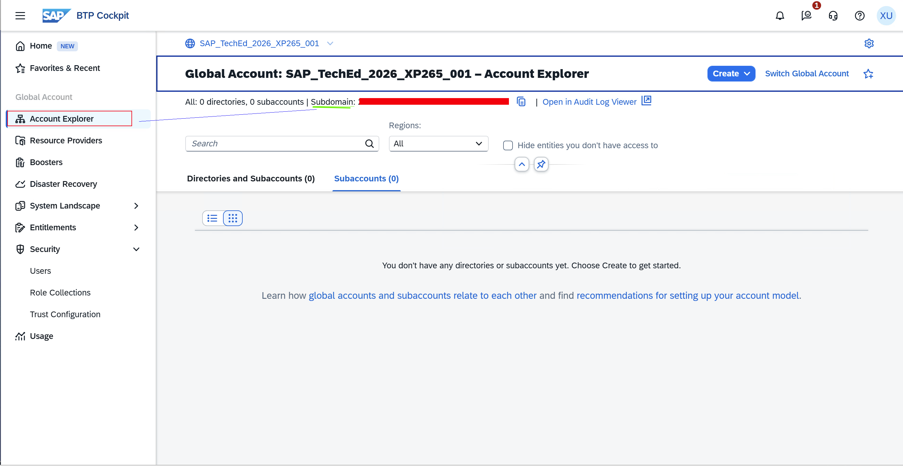

# Initialize the project

In this exercise, you will initialize the project and set up the necessary structure to begin the spec-driven flow in Claude Code.

## 🛠️ Execute the spec-kit init command

As a first step we must initialize the spec-driven development project. This is done by executing the `sap-iac init` command of the spec-kit CLI in a terminal. The command will create a project structure and a set of files that will be used in the following steps by the agent.

👉 Open a terminal and execute the following command (replace the `XX` with your group name):

```powershell
sap-iac init SAPTechEd2026-0XX
```

You will be asked:

- To select the agentic tooling you want to use.

    👉 Select `claude` as we will use **Claude Code** for this session.

- To specify the global account subdomain.

    👉 Provide the **subdomain** of your global account retrieved from the SAP BTP cockpit you logged in in the previous exercise.



The command will create a folder with the name `SAPTechEd2026-0XX`.

👉 Navigate into the folder using the command (replace the `XX` with your group name):

```powershell
cd SAPTechEd2026-0XX
```

Let us inspect the project structure.

👉  Open the content of the folder in Visual Studio Code (VS Code) by executing the following command in the terminal:

```powershell
code .
```

A VS Code screen opens displaying the following project structure:

```powershell
├── .sap-iac
│   └── platform-validation.md
├── .claude
│   └── commands
│       ├── sap-iac.accounts.md
│       ├── sap-iac.analyse.md
│       ├── sap-iac.connectivity.md
│       ├── sap-iac.design.md
│       ├── sap-iac.generate.md
│       ├── sap-iac.govern.md
│       ├── sap-iac.next.md
│       ├── sap-iac.scenario.md
│       ├── sap-iac.security.md
│       ├── sap-iac.services.md
│       └── sap-iac.tasks.md
├── .gitignore
├── memory
├── specs
└── terraform
```

Let's walk through the files and folders:

- The `.sap-iac` folder contains local file records and optional validation capabilities detected by `sap-iac init`.
- The `.claude` folder contains all the commands and the corresponding instructions for the agentic tooling (in this case Claude Code). These are the **skills** you will invoke throughout the exercises.
- The `.gitignore` file contains the files and folders that should be ignored by Git. This is important to avoid committing sensitive information or unnecessary files to the repository.
- The `memory` folder contains the memory of the agentic tooling. The governance constraints you will define in [Exercise 2](../ex2/README.md) live here and are read by the agent in every subsequent step.
- The `specs` folder contains the specifications that will be created when you interact with the different commands. By the end of [Exercise 9](../ex9/README.md), this folder will contain all specification documents for our setup.
- The `terraform` folder will contain the generated code that we will generate in [Exercise 10](../ex10/README.md).

> [!NOTE]
> Notice that the `memory`, `specs` and `terraform` folders are empty at this point. They will be populated progressively as you work through the exercises.

Keep the terminal open as you will need it for the subsequent exercises.

## 📋 Summary

>[!IMPORTANT]
> In the following exercises we will interact with an agentic tool. We cannot fully anticipate the output, hence questions might deviate and you might have to provide additional input like confirmations. Read the section explaining the intent of each exercise carefully, as this will help you in unforeseen interactions with the agent.

Now you are ready to start with the spec-driven development process. First you define the governance constraints that will act as guardrails for all subsequent steps.

👉 Continue to - [Exercise 3 - Define the governance constraints](../ex3/README.md)
